

<picture>
<source media="(prefers-reduced-motion: reduce)" srcset="./assets/wii/menu-static.png" />
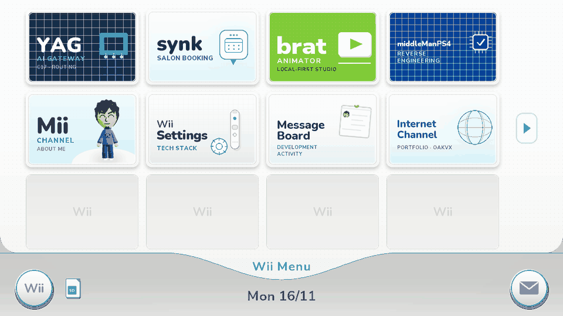
</picture>

 

<a href="https://oakvx.github.io/"><b>PORTFOLIO</b></a> &nbsp;·&nbsp;
<a href="https://oakvx.github.io/chi-sono/"><b>ABOUT</b></a> &nbsp;·&nbsp;
<a href="https://oakvx.github.io/fuori-orario/"><b>AFTER HOURS</b></a> &nbsp;·&nbsp;
<a href="https://github.com/oakvx/yag"><b>YAG</b></a> &nbsp;·&nbsp;
<a href="https://github.com/oakvx/synkris"><b>SYNK</b></a> &nbsp;·&nbsp;
<a href="mailto:gabrielelucia07@gmail.com"><b>EMAIL</b></a>

 

<b>Gabriele Lucia</b> &nbsp;·&nbsp; Sassuolo, Italy &nbsp;·&nbsp; Computer Engineering @ UNIMORE

 

The menu above is a decorative animation; GitHub renders it as a single image. Every channel in the grid below is an ordinary, clickable link.

<h2>
<picture>
<source media="(prefers-color-scheme: dark)" srcset="./assets/wii/headings/home-menu-dark.png" />

</picture>
</h2>

<table width="100%">
<tr>
<td width="25%" align="center" valign="top"><a href="https://github.com/oakvx/yag">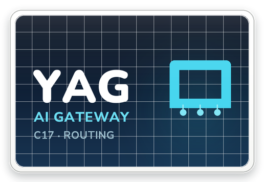</a></td>
<td width="25%" align="center" valign="top"><a href="https://github.com/oakvx/synkris">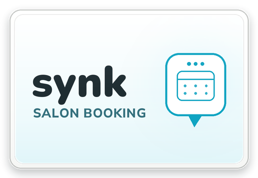</a></td>
<td width="25%" align="center" valign="top"><a href="https://github.com/oakvx/bratAnimator">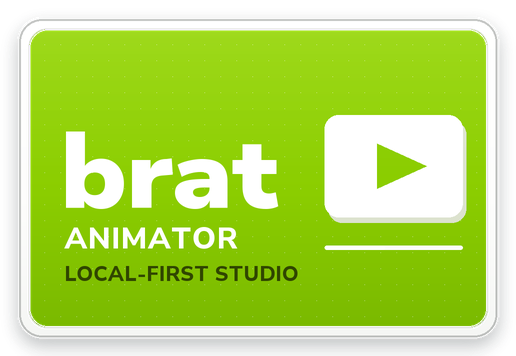</a></td>
<td width="25%" align="center" valign="top"><a href="https://github.com/oakvx/middleManPS4">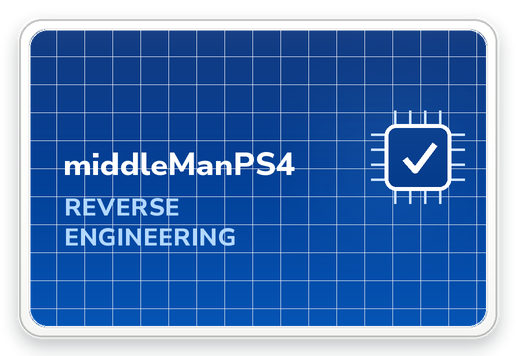</a></td>
</tr>
<tr>
<td width="25%" align="center" valign="top"><a href="#mii-channel">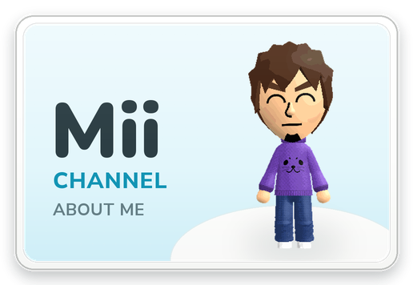</a></td>
<td width="25%" align="center" valign="top"><a href="#wii-settings">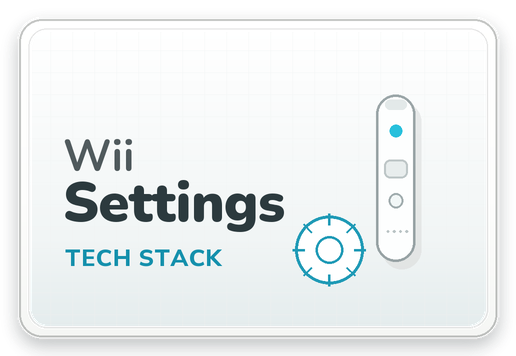</a></td>
<td width="25%" align="center" valign="top"><a href="#message-board">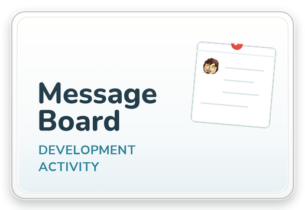</a></td>
<td width="25%" align="center" valign="top"><a href="#internet-channel">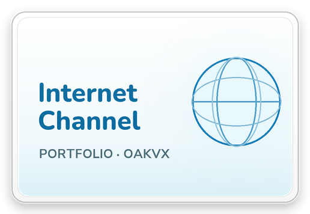</a></td>
</tr>
</table>

<a href="https://github.com/oakvx/yag"><b>YAG</b></a> · AI infrastructure &nbsp;|&nbsp; <a href="https://github.com/oakvx/synkris"><b>synk</b></a> · booking &amp; messaging &nbsp;|&nbsp; <a href="https://github.com/oakvx/bratAnimator"><b>Brat Animator</b></a> · creative tooling &nbsp;|&nbsp; <a href="https://github.com/oakvx/middleManPS4"><b>middleManPS4</b></a> · reverse engineering &nbsp;|&nbsp; <a href="#mii-channel"><b>Mii Channel</b></a> · about me &nbsp;|&nbsp; <a href="#wii-settings"><b>Wii Settings</b></a> · toolbox &nbsp;|&nbsp; <a href="#message-board"><b>Message Board</b></a> · activity &nbsp;|&nbsp; <a href="#internet-channel"><b>Internet Channel</b></a> · links

<h2>
<picture>
<source media="(prefers-color-scheme: dark)" srcset="./assets/wii/headings/mii-channel-dark.png" />

</picture>
</h2>

<table width="100%">
<tr>
<td width="44%" valign="top">
<picture>
<source media="(prefers-reduced-motion: reduce)" srcset="./assets/wii/mii-channel.png" />
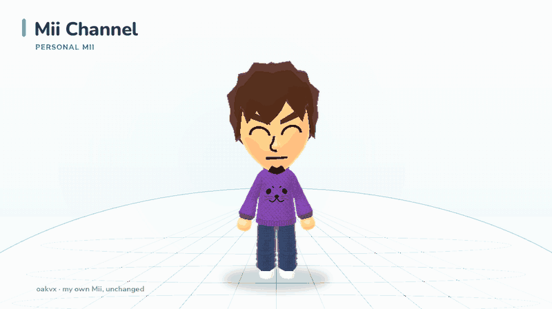
</picture>
</td>
<td width="56%" valign="top">

<b>Gabriele Lucia</b> — computer engineering student, software developer and graphic designer. I work on <b>both sides of a system</b>: the interface people touch, and the logic that has to hold up under real-world conditions.

My current focus is local-first software, AI infrastructure, reliable appointment workflows, browser-based creative tools and evidence-driven reverse engineering.

<ul>
<li><b>Software development</b> — from C17 services and PostgreSQL constraints to PHP dashboards and static sites.</li>
<li><b>UI and graphic design</b> — layouts, typography, icon systems, Canvas 2D graphics, accessible motion.</li>
<li><b>AI infrastructure</b> — an experimental multi-backend gateway with protocol adapters and operational limits.</li>
<li><b>Reverse engineering</b> — read-only diagnostics, offline binary analysis and evidence-tagged findings.</li>
</ul>

Studying <b>Computer Engineering</b> at the University of Modena and Reggio Emilia (UNIMORE). Based in Sassuolo, Italy.

<a href="https://oakvx.github.io/chi-sono/">More about me</a> · <a href="https://oakvx.github.io/fuori-orario/">After Hours</a> · <a href="mailto:gabrielelucia07@gmail.com">Email</a>

</td>
</tr>
</table>

### Career & education

| When | What |
| :-- | :-- |
| **2026 →** | **Computer Engineering**, University of Modena and Reggio Emilia (UNIMORE) |
| **Aug–Sep 2026** | **Software & automation apprentice**, Format SRL: industrial software, PLC support, SQL Server, T-SQL |
| **2023–Jun 2026** | **Freelance web developer & SEO consultant** for local businesses around Sassuolo and Scandiano |
| **May–Jun 2025** | **Erasmus+ at Starbotica, Seville:** IT support, Windows, Active Directory, local networks |
| **2021–2026** | **Computer Science & Telecommunications**, IIS A. Volta, Sassuolo; Beautify was my diploma project |

<h2>
<picture>
<source media="(prefers-color-scheme: dark)" srcset="./assets/wii/headings/software-channels-dark.png" />

</picture>
</h2>

### AI &amp; infrastructure

<table width="100%">
<tr>
<td width="22%" valign="top"></td>
<td width="78%" valign="top">

<a href="https://github.com/oakvx/yag"><b>YAG · Yet Another Gateway</b></a> · experimental · release candidate <code>v0.1.0-rc.2</code>

An AI gateway written in <b>C17</b>: authenticated access to multiple inference backends, OpenAI-compatible and Anthropic-compatible protocol adapters, per-model routing and operational limits. Includes a React/TypeScript control console and an optional cross-platform desktop chat client. The control plane covers LAN client keys, model operations, scheduling and backend management.

C17 · CMake · libcurl · React · TypeScript · AI infrastructure · GitHub Actions

Real-model compatibility and production security are still under qualification; not intended for exposure to untrusted networks.

<a href="https://github.com/oakvx/yag">Repository</a> · <a href="https://github.com/oakvx/yag/blob/main/docs/architecture/STATUS.md">Architecture &amp; status</a>

</td>
</tr>
</table>

### Backend &amp; app logic

<table width="100%">
<tr>
<td width="22%" valign="top"></td>
<td width="78%" valign="top">

<a href="https://github.com/oakvx/synkris"><b>synk</b></a> (formerly SYNKRIS) · release candidate <code>1.2.0-rc.6</code>

An on-premise salon booking and messaging platform integrating Google Calendar and WhatsApp. The current release candidate is for testing, not live customer data.

Docker Compose stack: Node.js bot, PHP dashboard, PostgreSQL 16. A GiST exclusion constraint makes double booking impossible; Google Calendar side effects flow through a transactional outbox with leases and fencing tokens, plus a compensation saga. WhatsApp via WhatsApp Web, optional local Ollama.

Node.js · PHP · PostgreSQL · Docker · Google Calendar API

Proprietary, source-available. Real-provider testing and security review pending.

<a href="https://github.com/oakvx/synkris">Repository</a> · <a href="https://oakvx.github.io/projects/synk/">Case study</a> · <a href="https://oakvxish.github.io/synkris.github.io/">Project site</a>

</td>
</tr>
</table>

**Beautify** — diploma project: a multi-salon CRM in PHP/MySQL covering clients, staff roles, appointments, stock and analytics, with per-salon data separation and shared availability checks.

PHP · MySQL · <a href="https://github.com/oakvxish/maturita">Code</a> · <a href="https://oakvx.github.io/projects/beautify/">Case study</a>

### Creative tools

<table width="100%">
<tr>
<td width="22%" valign="top"></td>
<td width="78%" valign="top">

<a href="https://github.com/oakvx/bratAnimator"><b>Brat Animator</b></a> · live

A local-only lyric-video studio with a Windows 7 desktop-style UI built on vendored <code>7.css</code>. A timestamp-driven Canvas 2D compositor keeps preview and export aligned; WebCodecs enables MP4 export when supported. Projects use IndexedDB and portable <code>.brat.zip</code> archives; PWA offline support included.

JavaScript · 7.css · Canvas 2D · WebCodecs · IndexedDB · PWA

<a href="https://github.com/oakvx/bratAnimator">Code</a> · <a href="https://oakvx.github.io/bratAnimator/">Try it</a> · <a href="https://oakvx.github.io/projects/brat-animator/">Case study</a>

</td>
</tr>
</table>

### Reverse engineering

<table width="100%">
<tr>
<td width="22%" valign="top"></td>
<td width="78%" valign="top">

<a href="https://github.com/oakvx/middleManPS4"><b>middleManPS4</b></a> · research / WIP · <code>v0.17</code>

Python (stdlib-only) host tooling and C payloads around three questions: how a payload gets loaded, what is inside the binaries, what is visible on the wire. ELF validation and delivery to <code>elfldr</code>, read-only firmware readout, an offline ELF/Orbis/PSF/NID toolkit with JSON/Markdown reports and optional Ghidra export, passive DNS/TCP/TLS metadata tools, and an offline workbench with integrity-checked reports.

Python · C payloads · ELF / Orbis / PSF / NID · Ghidra · passive DNS/TLS/TCP metadata

Tested on one console (PS4, 12.52, GoldHEN) where documented. Read-only diagnostics and offline analysis; no PSN-bypass or firmware-spoofing claims. <b>Evidence or it didn't happen.</b>

<a href="https://github.com/oakvx/middleManPS4">Code, evidence and roadmap</a>

</td>
</tr>
</table>

### Design &amp; web

- **Portfolio** — static site, no build step: vanilla HTML/CSS/JS, generated EN pages, CI checks for links, SEO, accessibility and sitemap, reduced-motion support. <a href="https://github.com/oakvx/oakvx.github.io">Code</a> · <a href="https://oakvx.github.io/">Visit</a>
- **Spinotto Felice** (fictional demo) — reusable small-business site: responsive layout, light/dark themes, FAQ, saved preferences. <a href="https://github.com/oakvx/autoOfficina">Code</a> · <a href="https://oakvx.github.io/autoOfficina/">Live demo</a> · <a href="https://oakvx.github.io/projects/autoofficina/">Case study</a>
- **Top Gun Fly School** (unofficial demo) — single-file landing page. Not for bookings or flight information. <a href="https://github.com/oakvx/topGun">Code</a> · <a href="https://oakvx.github.io/topGun/">Live demo</a>
- **Synkris site** — static project site with illustrative scenarios. The application lives in <a href="https://github.com/oakvx/synkris">oakvx/synkris</a>; the site is not a booking service. <a href="https://github.com/oakvxish/synkris.github.io">Website code</a> · <a href="https://oakvxish.github.io/synkris.github.io/">Visit</a>

<b>Demo credits:</b> Spinotto Felice's structure and style are mine; its fictional content and AI-generated images are by <a href="https://www.albertopecchini.it">Alberto Pecchini</a>. The business is invented; the demo takes no real orders or bookings.

<a href="https://github.com/oakvx?tab=repositories"><b>All repositories →</b></a>

<h2>
<picture>
<source media="(prefers-color-scheme: dark)" srcset="./assets/wii/headings/wii-settings-dark.png" />

</picture>
</h2>

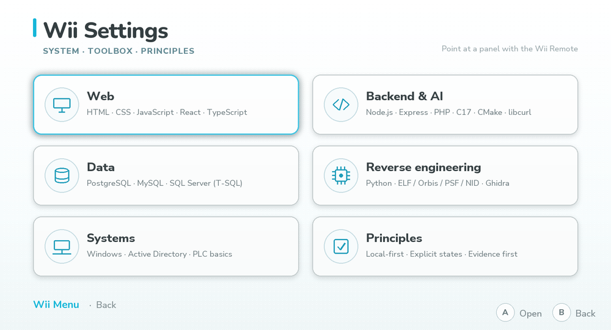

| Area | Tools |
| :-- | :-- |
| Web | HTML, CSS, JavaScript, React, TypeScript, 7.css, Canvas 2D, WebCodecs, MediaRecorder, IndexedDB, service workers, accessibility, SEO |
| Backend & AI infrastructure | Node.js, Express, PHP, C17, CMake, libcurl, Docker Compose, Git, GitHub Actions, OpenAI-compatible APIs |
| Data | PostgreSQL (constraints, outbox/queue patterns, `SKIP LOCKED`), MySQL, SQL Server (T-SQL) |
| Reverse engineering | Python, C payloads, ELF/Orbis/PSF/NID, Ghidra, passive DNS/TLS/TCP metadata |
| Systems | Windows, Active Directory, IT support, industrial software, PLC basics |

> [!TIP]
> **Principles:** local-first when it fits · explicit states over assumed success · evidence over assumptions · accessible motion.

<h2>
<picture>
<source media="(prefers-color-scheme: dark)" srcset="./assets/wii/headings/message-board-dark.png" />

</picture>
</h2>

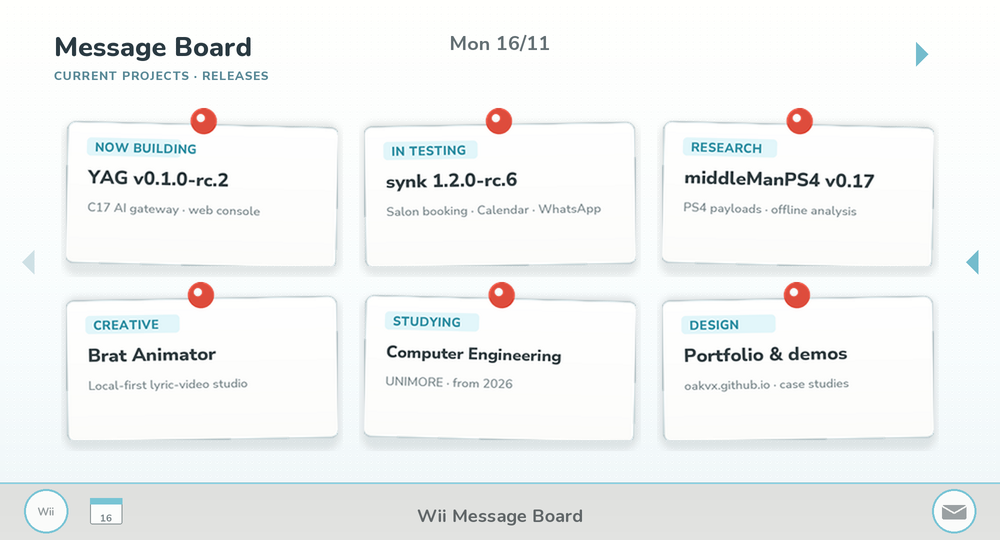

| Channel | State | Last release |
| :-- | :-- | :-- |
| **YAG** | Experimental; real-model qualification in progress | [`v0.1.0-rc.2`](https://github.com/oakvx/yag/releases) · 15 Nov 2026 |
| **synk** | Release candidate for testing; not live customer data | [`1.2.0-rc.6`](https://github.com/oakvx/synkris/releases) · 9 Nov 2026 |
| **Brat Animator** | Live on GitHub Pages; no tagged release yet | [Repository](https://github.com/oakvx/bratAnimator) |
| **middleManPS4** | Research / WIP; tested on one console | [`v0.17`](https://github.com/oakvx/middleManPS4) · in the README |
| **Portfolio** | Live; CI checks links, SEO, accessibility, sitemap | [oakvx.github.io](https://oakvx.github.io/) |

Release and commit data checked on 16 November 2026; nothing on this board is invented. Live history: <a href="https://github.com/oakvx/yag/commits">YAG</a> · <a href="https://github.com/oakvx/synkris/commits">synk</a> · <a href="https://github.com/oakvx/bratAnimator/commits">Brat Animator</a> · <a href="https://github.com/oakvx/middleManPS4/commits">middleManPS4</a>.

<h2>
<picture>
<source media="(prefers-color-scheme: dark)" srcset="./assets/wii/headings/internet-channel-dark.png" />

</picture>
</h2>

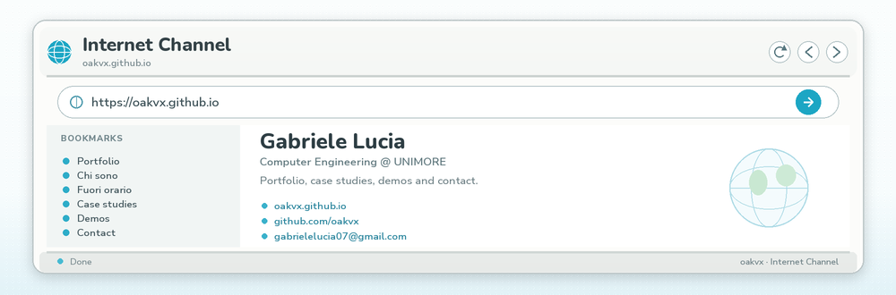

| Bookmark | What is there |
| :-- | :-- |
| [oakvx.github.io](https://oakvx.github.io/) | Portfolio home |
| [Chi sono](https://oakvx.github.io/chi-sono/) | About me, in Italian |
| [Fuori orario](https://oakvx.github.io/fuori-orario/) | After Hours |
| [Case study: Brat Animator](https://oakvx.github.io/projects/brat-animator/) | How the lyric-video editor is put together |
| [Case study: synk](https://oakvx.github.io/projects/synk/) | Booking, outbox and compensation design |
| [Case study: Beautify](https://oakvx.github.io/projects/beautify/) | The multi-salon CRM diploma project |
| [Case study: Spinotto Felice](https://oakvx.github.io/projects/autoofficina/) | The fictional shop demo |
| [bratAnimator](https://oakvx.github.io/bratAnimator/) | Live lyric-video editor |
| [autoOfficina](https://oakvx.github.io/autoOfficina/) | Spinotto Felice demo |
| [topGun](https://oakvx.github.io/topGun/) | Top Gun Fly School demo |
| [Synkris site](https://oakvxish.github.io/synkris.github.io/) | Project site |
| [GitHub](https://github.com/oakvx?tab=repositories) | All repositories |
| [Email](mailto:gabrielelucia07@gmail.com) | gabrielelucia07@gmail.com |

<h2>
<picture>
<source media="(prefers-color-scheme: dark)" srcset="./assets/wii/headings/after-hours-dark.png" />
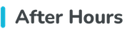
</picture>
</h2>

| | |
| :-- | :-- |
| **Languages** | Italian (native) · English (C1) · Spanish (B1) · Greek (B1) · Chinese (A2) |
| **Consoles** | Modded Nintendo 3DS (three), Wii U, Wii, PlayStation 4. The home menu of a certain mid-2000s console is the reason this page exists. |

<a href="https://oakvx.github.io/fuori-orario/"><b>Open After Hours →</b></a>

<b>My Mii, in motion</b>

 

These are animations of my own avatar, made for my website and reused here unchanged — same face, same purple cat sweater, same tendency to almost fall over.

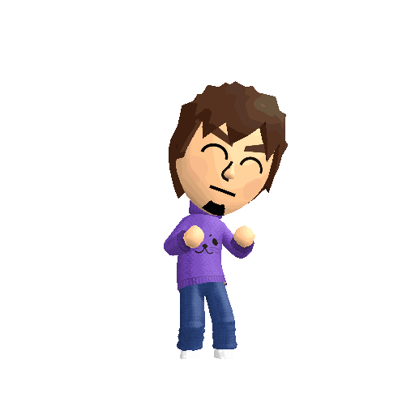
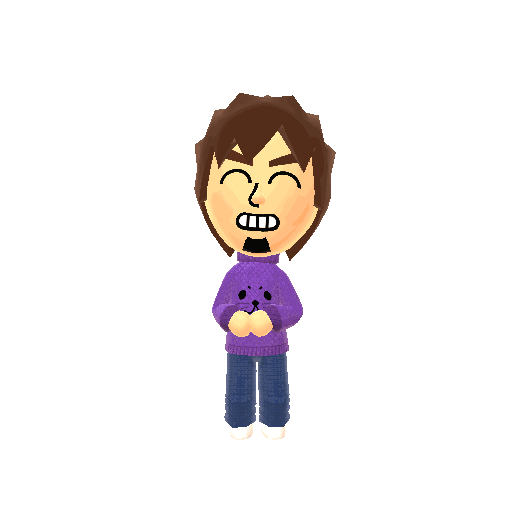
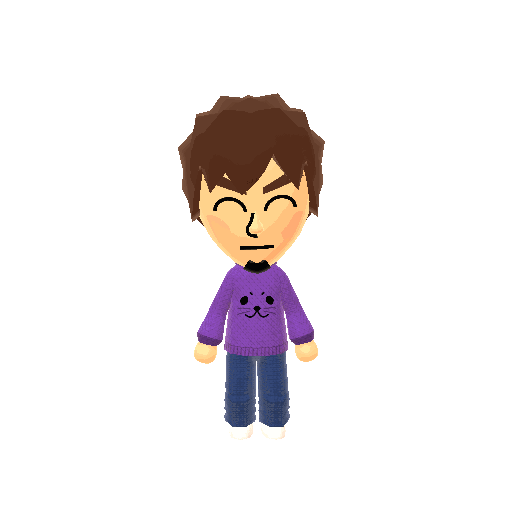
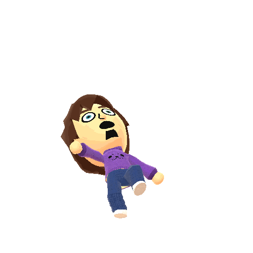

<b>How this page is made</b>

 

- One Markdown file. No CSS, no JavaScript, no build step, no external services at runtime — GitHub renders all of it, and every image is a file in this repository.
- The System Menu, channel frames, footer, screens and headings are drawn from scratch with Python and Pillow by [`tools/build_wii_assets.py`](./tools/build_wii_assets.py). Geometry, palette and wording follow the original Wii System Menu: dotted wallpaper, glossy white channel frames, cyan selection glow, silver footer and the central tray.
- The menu and Mii Channel animations are GIFs generated by the same script. A &lt;picture&gt; element offers the static frame when <code>prefers-reduced-motion</code> is set; if GitHub ignores that hint, the animation is still calm and loops with a pause.
- An animated image cannot contain clickable hotspots on GitHub, so the hero is decorative and the real, individually linked channels live in the Home Menu table below it.
- My Mii is my own artwork from [`assets/mii`](./assets/mii): the same frames are reused, never redrawn. Typefaces: Nunito and Nunito Sans, SIL Open Font License (see [`tools/fonts`](./tools/fonts)).
- Palette: warm white menu, silver hardware, cyan highlight (`#16b6dd`) — a quiet nod to a console home screen from 2006.
- This is a personal tribute. Not affiliated with Nintendo; Wii is a trademark of Nintendo.

<b>Leggi in italiano</b>

 

Sono **Gabriele Lucia**, di Sassuolo. Studio Ingegneria Informatica all'UNIMORE e mi divido tra sviluppo software, grafica e interfacce: la parte che le persone toccano, e la logica che deve reggere.

- **Infrastruttura AI:** [YAG](https://github.com/oakvx/yag), gateway sperimentale in C17 per autenticazione, routing di modelli, adattamento dei protocolli e gestione di più backend. Include una console React/TypeScript e un client desktop opzionale; compatibilità con modelli reali e sicurezza di produzione ancora in qualifica.
- **Backend e logica applicativa:** [synk](https://github.com/oakvx/synkris), sistema on-premise per appuntamenti, Google Calendar e WhatsApp (release candidate di collaudo); [Beautify](https://oakvx.github.io/projects/beautify/), CRM multi-salone del progetto di maturità.
- **Interfacce e creatività:** [Brat Animator](https://github.com/oakvx/bratAnimator), editor video interamente nel browser con desktop ispirato a Windows 7 e libreria 7.css.
- **Reverse engineering:** [middleManPS4](https://github.com/oakvx/middleManPS4), laboratorio per payload PS4, analisi offline di ELF/Orbis e osservabilità di rete sulla mia console. Solo diagnostica in lettura, nessuna dichiarazione di bypass PSN o spoofing firmware.
- **Design e web:** portfolio, demo Spinotto Felice, landing Top Gun Fly School e sito Synkris.

Ho lavorato come sviluppatore web freelance e consulente SEO, ho fatto supporto IT durante l'Erasmus a Siviglia e mi sono occupato di software industriale, PLC e SQL Server.

Questa pagina è un tributo personale al menu di una console del 2006: ogni grafica è disegnata da zero, il mio Mii è il mio, e il menu animato è un'immagine decorativa mentre i canali della griglia sono link veri.

<a href="mailto:gabrielelucia07@gmail.com">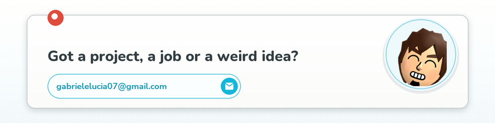</a>

<a href="mailto:gabrielelucia07@gmail.com">Email</a> &nbsp;·&nbsp;
<a href="https://oakvx.github.io/">Portfolio</a> &nbsp;·&nbsp;
<a href="https://github.com/oakvx">GitHub</a> &nbsp;·&nbsp;
<a href="https://github.com/oakvx/synkris">synk</a> &nbsp;·&nbsp;
<a href="https://github.com/oakvx/yag">YAG</a>

© 2026 Gabriele Lucia · Graphics, Mii and code are my own work. Wii is a trademark of Nintendo; this is an unofficial tribute.

