

<a href="https://oakvx.github.io/" title="Open my portfolio">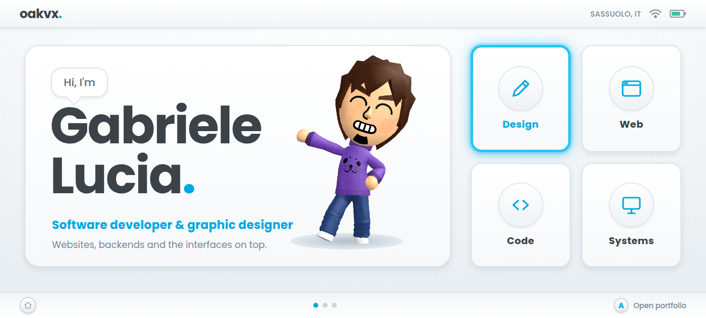</a>

 

<a href="https://oakvx.github.io/"><b>PORTFOLIO</b></a> &nbsp; · &nbsp;
<a href="https://oakvx.github.io/chi-sono/"><b>ABOUT</b></a> &nbsp; · &nbsp;
<a href="https://oakvx.github.io/fuori-orario/"><b>AFTER HOURS</b></a> &nbsp; · &nbsp;
<a href="https://github.com/oakvx/synkris"><b>SYNK</b></a> &nbsp; · &nbsp;
<a href="https://github.com/oakvx/yag"><b>YAG</b></a> &nbsp; · &nbsp;
<a href="https://github.com/oakvx/piko"><b>PIKO</b></a> &nbsp; · &nbsp;
<a href="mailto:gabrielelucia07@gmail.com"><b>EMAIL</b></a>

 

Sassuolo, Italy &nbsp; · &nbsp; Computer Engineering @ UNIMORE

 

<picture>
<source media="(prefers-color-scheme: dark)" srcset="https://raw.githubusercontent.com/oakvx/oakvx/output/snake-dark.svg" />

</picture>

<h3>
<picture>
<source media="(prefers-color-scheme: dark)" srcset="./assets/headings/hello-dark.png" />

</picture>
</h3>

Computer engineering student, software developer and graphic designer. I work on **both sides of a system**: the interface people touch, and the logic that has to hold up under real-world conditions. My current focus is local-first software, AI infrastructure, reliable appointment workflows, browser-based creative tools, local-first AI agents and evidence-driven reverse engineering.

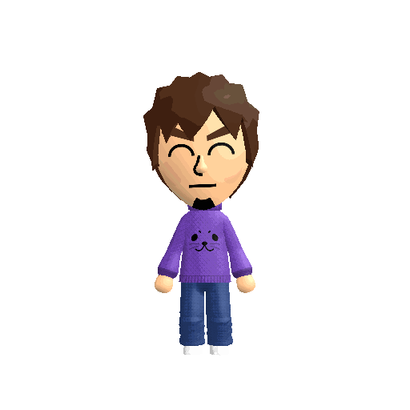

**Open to:** internships · freelance · interesting side projects

**EN** · [**IT**](#it)

<h2>
<picture>
<source media="(prefers-color-scheme: dark)" srcset="./assets/headings/right-now-dark.png" />

</picture>
</h2>

- ▶ **Building:** [YAG — Yet Another Gateway](https://github.com/oakvx/yag), an experimental C17 AI gateway at v0.1.0-rc.2 with multi-backend routing, protocol adapters, a web console and an optional desktop client.
- ▶ **Building:** [Piko](https://github.com/oakvx/piko), a Windows-first local agent that observes the app in front of it, writes a plan with a local Ollama model and only clicks and types after you approve. Alpha preview.
- ▶ **Developing:** [synk](https://github.com/oakvx/synkris), an on-premise salon booking and messaging platform integrating Google Calendar and WhatsApp. The current release candidate (1.2.0-rc.6, weekly 2026-11-16) is for testing, not live customer data.
- ▶ **Designing:** [Brat Animator](https://github.com/oakvx/bratAnimator), an entirely client-side lyric-video editor with a Windows 7-inspired desktop powered by 7.css. Latest: timed syllable continuations render with a hyphen until a split word completes.
- ▶ **Researching:** [middleManPS4](https://github.com/oakvx/middleManPS4), a PS4 payload and offline analysis toolkit with evidence-tagged findings.
- ▶ **Studying:** Computer Engineering at the University of Modena and Reggio Emilia.

Recently pushed · auto-updated by Actions

<!-- RECENT:START -->
- [`oye`](https://github.com/oakvx/oye) · updated 2026-11-23
- [`synkris`](https://github.com/oakvx/synkris) · updated 2026-11-23
- [`yag`](https://github.com/oakvx/yag) · updated 2026-11-23
- [`oakvx.github.io`](https://github.com/oakvx/oakvx.github.io) · updated 2026-11-21
- [`piko`](https://github.com/oakvx/piko) · updated 2026-11-19
<!-- RECENT:END -->

<h2>
<picture>
<source media="(prefers-color-scheme: dark)" srcset="./assets/headings/projects-dark.png" />

</picture>
</h2>

<h3>
<picture>
<source media="(prefers-color-scheme: dark)" srcset="./assets/headings/backend-app-logic-dark.png" />

</picture>
</h3>

<table>
<tr>
<td width="100%" valign="top">
<a href="https://github.com/oakvx/yag">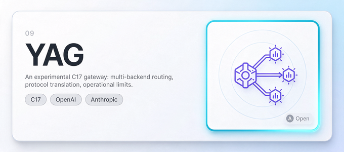</a>
 
<a href="https://github.com/oakvx/yag"><b>YAG · Yet Another Gateway</b></a> · experimental · v0.1.0-rc.2
  
An AI gateway written in <b>C17</b>: authenticated access to multiple inference backends, OpenAI-compatible and Anthropic-compatible protocol adapters, per-model routing and operational limits. Includes a React/TypeScript control console and an optional cross-platform desktop chat client. The control plane covers LAN client keys, model operations, scheduling and backend management.
  
C17 · CMake · libcurl · React · TypeScript · AI infrastructure · GitHub Actions
  
v0.1.0-rc.2 (2026-11-15): Linux host tarball and Windows/macOS/Linux desktop installers.
  
<a href="https://github.com/oakvx/yag"><b>Repository</b></a> · <a href="https://github.com/oakvx/yag/blob/main/docs/architecture/STATUS.md">Architecture &amp; status</a>
</td>
</tr>
</table>

> [!WARNING]
> **YAG is experimental:** real-model compatibility and production security are still under qualification. Don't expose it to untrusted networks.

YAG request flow — simplified, [full details](https://github.com/oakvx/yag/blob/main/docs/architecture/STATUS.md)

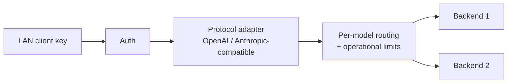

<table>
<tr>
<td width="100%" valign="top">
<a href="https://github.com/oakvx/piko">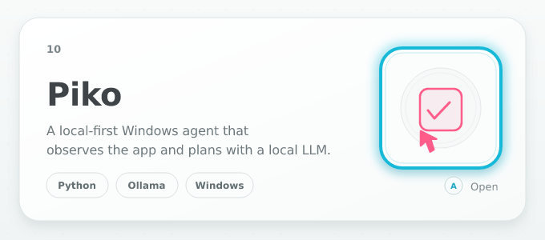</a>
 
<a href="https://github.com/oakvx/piko"><b>Piko</b></a> · alpha preview · Windows x64
  
A local-first Windows agent that looks at the app in front of it, writes a plan with a local Ollama model, waits for you to read it, and only then clicks and types. No cloud, no background screen stream, no action without your approval. Per-session, per-app permissions, an SQLite session state machine, a consent-based Teach recorder, importable/exportable Skills and a React/Tauri desktop UI (Workfield).
  
Python · FastAPI · SQLite · Ollama · Windows UI Automation · React · Tauri
 
Alpha preview, not a stable release. CI covers Windows/Linux, a real WinForms UI Automation smoke and the NSIS install/launch/close/uninstall lifecycle; clean Windows 10/11 VMs and real Ollama reasoning inference are not certified. Not for sensitive, destructive or financial tasks.
 
Latest preview: Piko-0.1.192-d9a17aa16daa, Windows x64 NSIS installer (2026-11-19).
  
<a href="https://github.com/oakvx/piko"><b>Repository</b></a> · <a href="https://github.com/oakvx/piko/releases">Latest preview</a>
</td>
</tr>
</table>

<table>
<tr>
<td width="33.33%" valign="top">
<a href="https://oakvx.github.io/bratAnimator/">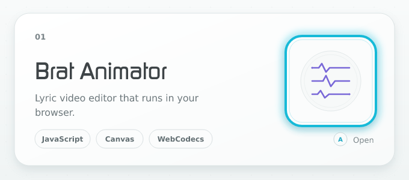</a>
 
<b>Brat Animator</b> 
Local-only lyric-video studio with a Windows 7 desktop-style UI built on vendored <code>7.css</code>. A timestamp-driven Canvas 2D compositor keeps preview and export aligned; WebCodecs enables MP4 export when supported. Projects use IndexedDB and portable <code>.brat.zip</code> archives; PWA offline support included. Latest: timed syllable continuations render with a hyphen until a split word completes (TTML, Lyricsfile and Enhanced LRC in Brat mode).
 
JavaScript · 7.css · Canvas 2D · WebCodecs · IndexedDB · PWA
 
<a href="https://github.com/oakvx/bratAnimator">Code</a> · <a href="https://oakvx.github.io/bratAnimator/">Try it</a> · <a href="https://oakvx.github.io/projects/brat-animator/">Case study</a>
</td>
<td width="33.33%" valign="top">
<a href="https://github.com/oakvx/synkris">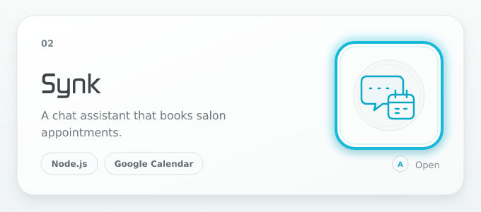</a>
 
<b>synk</b> (formerly SYNKRIS) · 1.2.0-rc.6 · weekly 2026-11-16 
Docker Compose stack: Node.js bot, PHP dashboard, PostgreSQL 16. A GiST exclusion constraint makes double booking impossible; Google Calendar side effects flow through a transactional outbox with leases and fencing tokens, plus a compensation saga. WhatsApp via WhatsApp Web, optional local Ollama.
 
Node.js · PHP · PostgreSQL · Docker · Google Calendar API 
Proprietary, source-available.
 
<a href="https://github.com/oakvx/synkris"><b>Repository</b></a> · <a href="https://oakvx.github.io/projects/synk/">Case study</a> · <a href="https://oakvxish.github.io/synkris.github.io/">Project site</a>
</td>
<td width="33.33%" valign="top">
<a href="https://oakvx.github.io/projects/beautify/">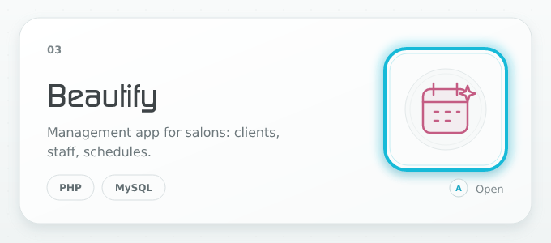</a>
 
<b>Beautify</b> 
Diploma project: multi-salon CRM in PHP/MySQL covering clients, staff roles, appointments, stock and analytics, with per-salon data separation and shared availability checks.
 
PHP · MySQL
 
<a href="https://github.com/oakvxish/maturita">Code</a> · <a href="https://oakvx.github.io/projects/beautify/">Case study</a>
</td>
</tr>
</table>

synk booking &amp; calendar flow — simplified, [full details](https://github.com/oakvx/synkris)

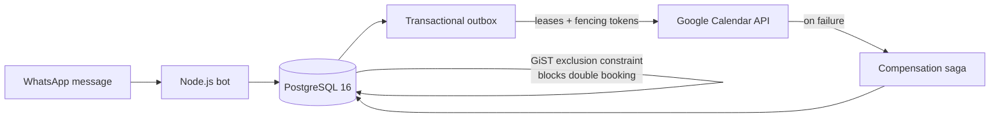

> [!NOTE]
> **synk** is a release candidate for testing, not for live customer data. Real-provider testing and security review are pending.

<h3>
<picture>
<source media="(prefers-color-scheme: dark)" srcset="./assets/headings/reverse-engineering-dark.png" />

</picture>
</h3>

<table>
<tr>
<td width="100%" valign="top">
<a href="https://github.com/oakvx/middleManPS4">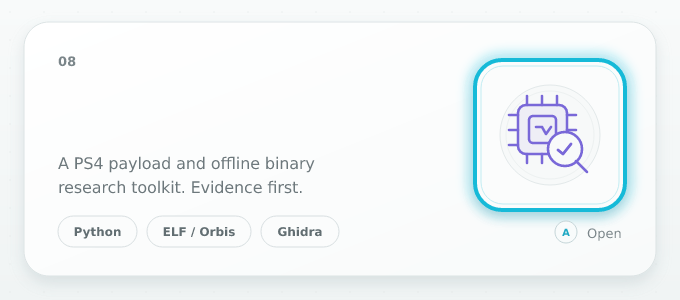</a>
 
<b>middleManPS4</b> · research / WIP · v0.17
  
Python (stdlib-only) host tooling and C payloads around three questions: how a payload gets loaded, what is inside the binaries, what is visible on the wire. ELF validation and delivery to <code>elfldr</code>, read-only firmware readout, an offline ELF/Orbis/PSF/NID toolkit with JSON/Markdown reports and optional Ghidra export, passive DNS/TCP/TLS metadata tools, and an offline workbench with integrity-checked reports.
  
Tested on one console (PS4, 12.52, GoldHEN) where documented. Read-only diagnostics and offline analysis; no PSN-bypass or firmware-spoofing claims. <b>Evidence or it didn't happen.</b>
  
<a href="https://github.com/oakvx/middleManPS4">Code, evidence and roadmap</a>
</td>
</tr>
</table>

<h3>
<picture>
<source media="(prefers-color-scheme: dark)" srcset="./assets/headings/design-web-dark.png" />

</picture>
</h3>

<table>
<tr>
<td width="50%" valign="top">
<a href="https://oakvx.github.io/">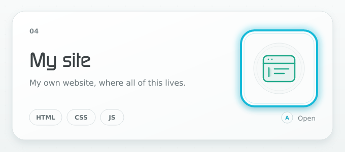</a>
 
<b>Portfolio</b> 
Static site, no build step: vanilla HTML/CSS/JS, generated EN pages, CI checks for links, SEO, accessibility and sitemap, reduced-motion support.
 
<a href="https://github.com/oakvx/oakvx.github.io">Code</a> · <a href="https://oakvx.github.io/">Visit</a>
</td>
<td width="50%" valign="top">
<a href="https://oakvx.github.io/autoOfficina/">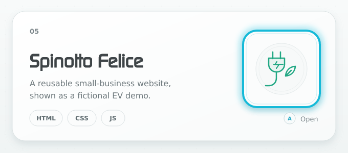</a>
 
<b>Spinotto Felice</b> (fictional demo) 
Reusable small-business site: responsive layout, light/dark themes, FAQ, saved preferences.
 
<a href="https://github.com/oakvx/autoOfficina">Code</a> · <a href="https://oakvx.github.io/autoOfficina/">Live demo</a> · <a href="https://oakvx.github.io/projects/autoofficina/">Case study</a>
</td>
</tr>
<tr>
<td width="50%" valign="top">
<a href="https://oakvx.github.io/topGun/">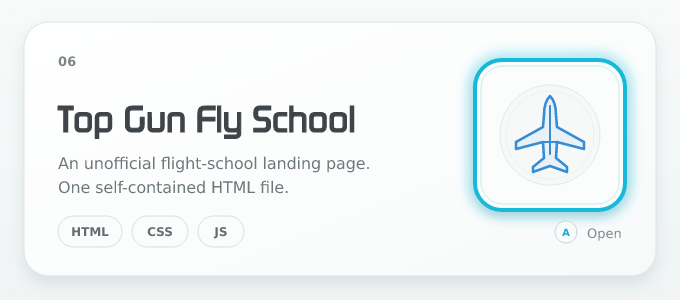</a>
 
<b>Top Gun Fly School</b> (unofficial demo) 
Single-file landing page. Not for bookings or flight information.
 
<a href="https://github.com/oakvx/topGun">Code</a> · <a href="https://oakvx.github.io/topGun/">Live demo</a>
</td>
<td width="50%" valign="top">
<a href="https://oakvxish.github.io/synkris.github.io/">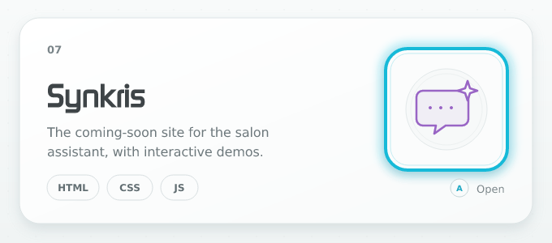</a>
 
<b>Synkris site</b> 
Static project site with illustrative scenarios. The application lives in <a href="https://github.com/oakvx/synkris"><b>oakvx/synkris</b></a>; the site is not a booking service.
 
<a href="https://github.com/oakvxish/synkris.github.io">Website code</a> · <a href="https://oakvxish.github.io/synkris.github.io/">Visit</a>
</td>
</tr>
</table>

<b>Demo credits:</b> Spinotto Felice's structure and style are mine; its fictional content and AI-generated images are by <a href="https://www.albertopecchini.it">Alberto Pecchini</a>. The business is invented; the demo takes no real orders or bookings.

<a href="https://github.com/oakvx?tab=repositories"><b>All repositories →</b></a>

<h2>
<picture>
<source media="(prefers-color-scheme: dark)" srcset="./assets/headings/focus-toolbox-dark.png" />

</picture>
</h2>

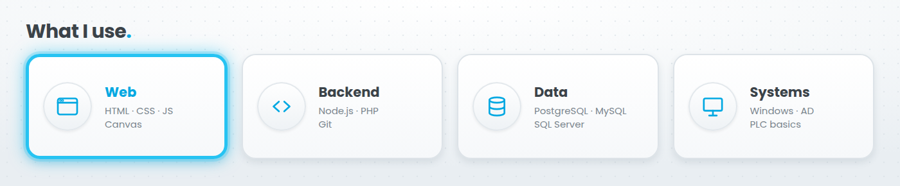

| Area | Tools |
| :-- | :-- |
| Web | HTML, CSS, JavaScript, React, TypeScript, 7.css, Canvas 2D, WebCodecs, MediaRecorder, IndexedDB, service workers, accessibility, SEO |
| Backend & AI infrastructure | Node.js, Express, PHP, C17, CMake, libcurl, Docker Compose, Python, FastAPI, SQLite, Ollama, Git, GitHub Actions, OpenAI-compatible APIs |
| Data | PostgreSQL (constraints, outbox/queue patterns, `SKIP LOCKED`), MySQL, SQL Server (T-SQL), SQLite |
| Reverse engineering | Python, C payloads, ELF/Orbis/PSF/NID, Ghidra, passive DNS/TLS/TCP metadata |
| Systems | Windows, Windows UI Automation, NSIS, Active Directory, IT support, industrial software, PLC basics |

> [!TIP]
> **Principles:** local-first when it fits · explicit states over assumed success · evidence over assumptions · accessible motion.

<b>Where I've been</b>

| When | What |
| :-- | :-- |
| **2026 →** | **Computer Engineering**, University of Modena and Reggio Emilia (UNIMORE) |
| **Aug–Sep 2026** | **Software & automation apprentice**, Format SRL: industrial software, PLC support, SQL Server, T-SQL |
| **2023–Jun 2026** | **Freelance web developer & SEO consultant** for local businesses around Sassuolo and Scandiano |
| **May–Jun 2025** | **Erasmus+ at Starbotica, Seville:** IT support, Windows, Active Directory, local networks |
| **2021–2026** | **Computer Science & Telecommunications**, IIS A. Volta, Sassuolo; Beautify was my diploma project |

<h2>
<picture>
<source media="(prefers-color-scheme: dark)" srcset="./assets/headings/after-hours-dark.png" />

</picture>
</h2>

| | |
| :-- | :-- |
| **Languages** | Italian (native) · English (C1) · Spanish (B1) · Greek (B1) · Chinese (A2) |
| **Consoles** | Modded Nintendo 3DS (three), Wii U, Wii, PlayStation 4. The home menu of a certain early-2010s console inspired the look of this page. |

<a href="https://oakvx.github.io/fuori-orario/"><b>Open After Hours →</b></a>

<b>My avatar, in motion</b>

Animations of my avatar made for my website.

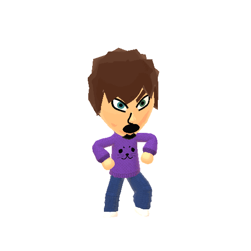

<b>How this page is made</b>

- One Markdown file. No CSS, no JS, no build step, no third-party widgets — GitHub renders all of it.
- The headings are pre-rendered PNGs; a <code>&lt;picture&gt;</code> element swaps them when your theme changes.
- Banner, project tiles, toolkit and contact art: drawn from scratch.
- The Mii-style avatar is mine too. He mostly idles. Sometimes he almost falls.
- Palette: bright white menu, cyan highlight (<code>#16bad8</code>) — a quiet nod to a console home screen from the early 2010s.

<h2>Leggi in italiano</h2>

Sono **Gabriele Lucia**, di Sassuolo. Studio Ingegneria Informatica all'UNIMORE e mi divido tra sviluppo software, grafica e interfacce: la parte che le persone toccano, e la logica che deve reggere.

- **Infrastruttura AI:** [YAG](https://github.com/oakvx/yag), gateway sperimentale in C17 (v0.1.0-rc.2) per autenticazione, routing di modelli, adattamento dei protocolli e gestione di più backend.
- **Agente locale:** [Piko](https://github.com/oakvx/piko), agente Windows-first che osserva l'app in primo piano, pianifica con un modello Ollama locale e clicca/digita solo dopo la tua approvazione (alpha preview).
- **Backend e logica applicativa:** [synk](https://github.com/oakvx/synkris), sistema on-premise per appuntamenti, Google Calendar e WhatsApp (1.2.0-rc.6, weekly 2026-11-16, release candidate di collaudo); Beautify.
- **Interfacce e creatività:** [Brat Animator](https://github.com/oakvx/bratAnimator), editor video interamente nel browser con desktop ispirato a Windows 7 e libreria 7.css — ultima aggiunta: trattini temporizzati per parole spezzate in Brat mode.
- **Reverse engineering:** [middleManPS4](https://github.com/oakvx/middleManPS4), laboratorio per payload PS4, analisi offline di ELF/Orbis e osservabilità di rete sulla mia console.
- **Design e web:** portfolio, demo Spinotto Felice, landing Top Gun Fly School e sito Synkris.

Ho lavorato come sviluppatore web freelance e consulente SEO, ho fatto supporto IT durante l'Erasmus a Siviglia e mi sono occupato di software industriale, PLC e SQL Server.

<a href="mailto:gabrielelucia07@gmail.com">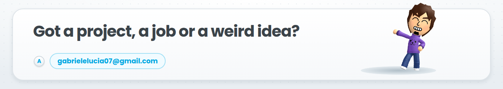</a>

<a href="mailto:gabrielelucia07@gmail.com">Email</a> &nbsp; · &nbsp;
<a href="https://oakvx.github.io/">Portfolio</a> &nbsp; · &nbsp;
<a href="https://github.com/oakvx">GitHub</a> &nbsp; · &nbsp;
<a href="https://github.com/oakvx/synkris">synk</a> &nbsp; · &nbsp;
<a href="https://github.com/oakvx/yag">YAG</a> &nbsp; · &nbsp;
<a href="https://github.com/oakvx/piko">Piko</a>

© 2026 Gabriele Lucia · Graphics and avatar are my own work.

