<!--
  Gabriele Lucia — GitHub profile.
  Look: bright white menu, cyan highlight, rounded tiles. Loosely inspired by a console home screen from the early 2010s.
  All graphics are drawn from scratch; the Mii-style avatar is my own.
  GitHub renders Markdown, images, tables and 
. No custom CSS or JS.
-->

<a href="https://oakvx.github.io/" title="Open my portfolio">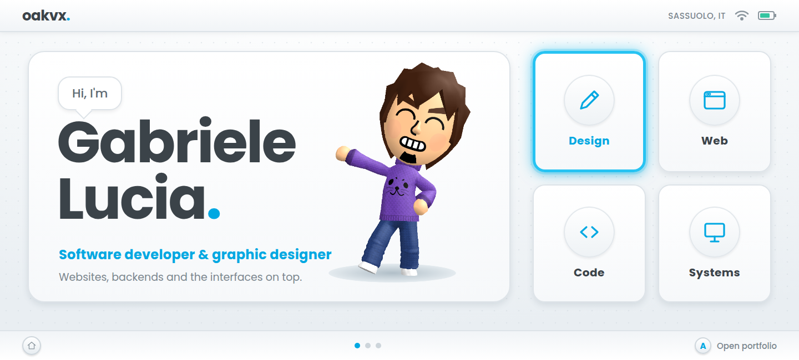</a>

 

<a href="https://oakvx.github.io/"><b>PORTFOLIO</b></a> &nbsp; · &nbsp;
<a href="https://oakvx.github.io/chi-sono/"><b>ABOUT</b></a> &nbsp; · &nbsp;
<a href="https://oakvx.github.io/fuori-orario/"><b>AFTER HOURS</b></a> &nbsp; · &nbsp;
<a href="https://github.com/oakvx/synkris"><b>SYNKRIS</b></a> &nbsp; · &nbsp;
<a href="mailto:gabrielelucia07@gmail.com"><b>EMAIL</b></a>

 

Sassuolo, Italy &nbsp; · &nbsp; Computer Engineering @ UNIMORE

<h3>
<picture>
<source media="(prefers-color-scheme: dark)" srcset="./assets/headings/hello-dark.png" />

</picture>
</h3>

I'm a computer engineering student, junior software developer and graphic designer. I like both sides of a project: **the interface people touch and the logic that makes it work**. Most of what is below started as something I needed, wanted to understand, or thought should exist.

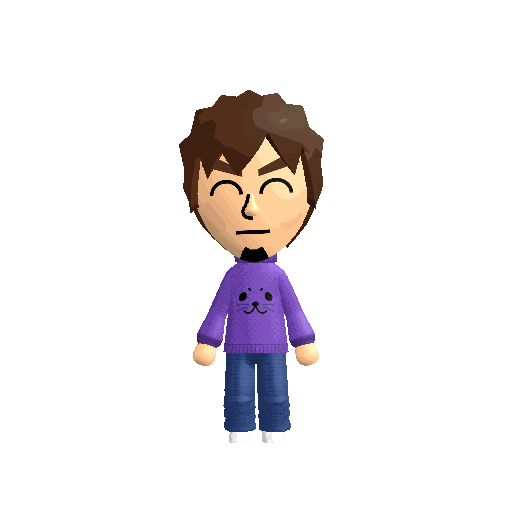

<h2>
<picture>
<source media="(prefers-color-scheme: dark)" srcset="./assets/headings/right-now-dark.png" />
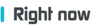
</picture>
</h2>

- **Researching:** PS4 payloads, ELF/Orbis binaries and network observability with **middleManPS4**, on hardware I own.
- **Building:** **[synk / SYNKRIS](https://github.com/oakvx/synkris)**, a local-first appointment and messaging system for salons. The current 1.2.0 RC6 is for testing, not live customer deployments.
- **Recently updated:** **[Brat Animator](https://github.com/oakvx/bratAnimator)**, a browser lyric-video editor with kinetic compositions, synchronized lyrics and portable projects.
- **Studying:** Computer Engineering at the University of Modena and Reggio Emilia.
- **Designing:** interfaces, graphics and small Mii animations alongside the code—not as an afterthought.

<h2>
<picture>
<source media="(prefers-color-scheme: dark)" srcset="./assets/headings/projects-dark.png" />

</picture>
</h2>

<h3>
<picture>
<source media="(prefers-color-scheme: dark)" srcset="./assets/headings/design-web-dark.png" />
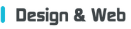
</picture>
</h3>

*Sites, interfaces and visual systems: the part people see and touch.*

<table>
<tr>
<td width="50%" valign="top">
<a href="https://oakvx.github.io/">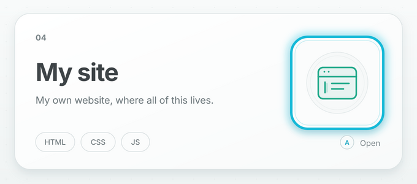</a>
 
My console-inspired, multilingual portfolio. Plain HTML, CSS and JavaScript, custom graphics and Mii animations, with reduced-motion support.
 
<a href="https://github.com/oakvx/oakvx.github.io">Code</a> · <a href="https://oakvx.github.io/">Visit</a>
</td>
<td width="50%" valign="top">
<a href="https://oakvx.github.io/autoOfficina/">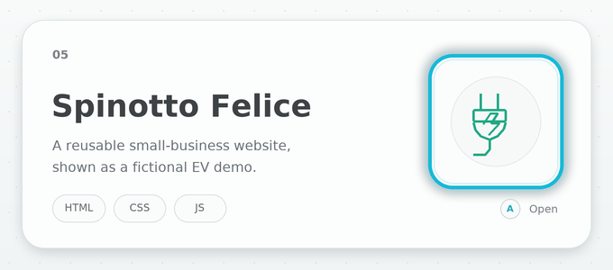</a>
 
A reusable small-business website, presented as a fully fictional EV-accessories demo. Responsive layout, light/dark themes, FAQ and saved preferences.
 
<a href="https://github.com/oakvx/autoOfficina">Code</a> · <a href="https://oakvx.github.io/autoOfficina/">Live demo</a> · <a href="https://oakvx.github.io/projects/autoofficina/">Case study</a>
</td>
</tr>
<tr>
<td width="50%" valign="top">
<a href="https://oakvx.github.io/topGun/">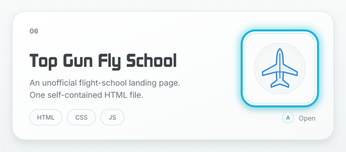</a>
 
An unofficial, non-affiliated landing-page demo for an ultralight flight school, built in one HTML file. Not for bookings or operational flight information.
 
<a href="https://github.com/oakvx/topGun">Code</a> · <a href="https://oakvx.github.io/topGun/">Live demo</a>
</td>
<td width="50%" valign="top">
<a href="https://oakvxish.github.io/synkris.github.io/">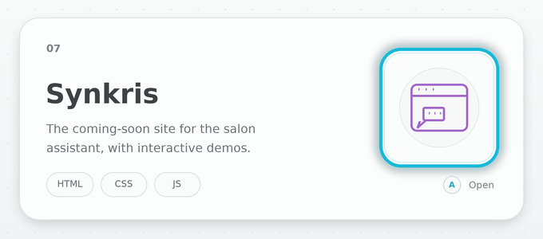</a>
 
A static project site with illustrative scenarios. The application itself is maintained separately in <a href="https://github.com/oakvx/synkris"><b>oakvx/synkris</b></a>; the website is not a live booking service.
 
<a href="https://github.com/oakvxish/synkris.github.io">Website code</a> · <a href="https://oakvxish.github.io/synkris.github.io/">Visit</a> · <a href="https://github.com/oakvx/synkris">Application code</a>
</td>
</tr>
</table>

<b>Demo credits:</b> Spinotto Felice's original structure and style are mine; its fictional content and AI-generated images are by <a href="https://www.albertopecchini.it">Alberto Pecchini</a>. The business is invented and the demo does not take real orders or bookings.

<h3>
<picture>
<source media="(prefers-color-scheme: dark)" srcset="./assets/headings/backend-app-logic-dark.png" />

</picture>
</h3>

*Server-side systems and logic-heavy browser apps: data, timing, automation and export pipelines.*

<table>
<tr>
<td width="33.33%" valign="top">
<a href="https://oakvx.github.io/bratAnimator/">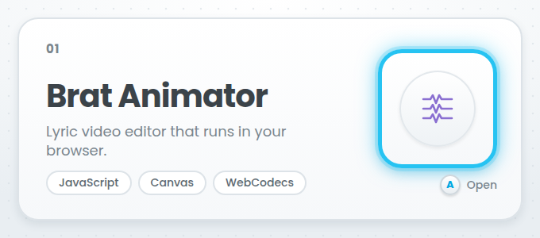</a>
 
A browser-based lyric-video studio, now at <b>v5.0</b>. Multi-format lyrics, direct Canvas editing, bilingual projects, custom fonts and portable <code>.brat.zip</code> files. MP4, WebM or PNG export with no processing backend.
 
<a href="https://github.com/oakvx/bratAnimator">Code</a> · <a href="https://oakvx.github.io/bratAnimator/">Try it</a> · <a href="https://oakvx.github.io/projects/brat-animator/">Case study</a>
</td>
<td width="33.33%" valign="top">
<a href="https://github.com/oakvx/synkris">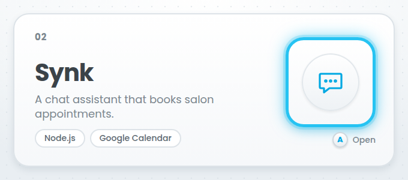</a>
 
<b>synk / SYNKRIS · 1.2.0 RC6 (testing)</b> 
An on-premise salon management and appointment assistant. Node.js and PHP, PostgreSQL, Google Calendar synchronization, WhatsApp Web integration and an optional local Ollama runtime. The dashboard tracks pending and uncertain operations instead of treating them as confirmed.
 
Reconstructed prerelease; real-provider testing and security review are still required. Proprietary, source-available license.
 
<a href="https://github.com/oakvx/synkris"><b>Repository</b></a> · <a href="https://oakvx.github.io/projects/synk/">Case study</a> · <a href="https://oakvxish.github.io/synkris.github.io/">Project site</a>
</td>
<td width="33.33%" valign="top">
<a href="https://oakvx.github.io/projects/beautify/">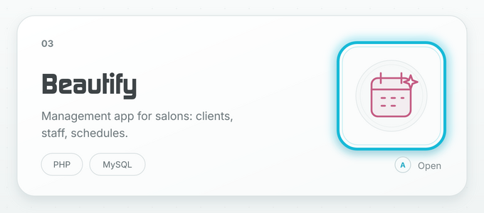</a>
 
My diploma project: a multisalon PHP/MySQL CRM for clients, staff roles, appointments, stock and analytics, with per-salon data separation and shared availability checks.
 
<a href="https://github.com/oakvxish/maturita">Code</a> · <a href="https://oakvx.github.io/projects/beautify/">Case study</a>
</td>
</tr>
</table>

<b>The common thread.</b> Whether it runs on a server or entirely in the browser, I enjoy turning messy input into a clear, useful flow: a message becomes an appointment, a timestamp becomes an animation, a schedule becomes an available slot. Useful first. Portable when possible. The implementation details matter.

<h3>
<picture>
<source media="(prefers-color-scheme: dark)" srcset="./assets/headings/reverse-engineering-dark.png" />
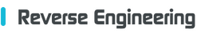
</picture>
</h3>

*Looking under the surface, testing assumptions and keeping the evidence.*

<table>
<tr>
<td width="100%" valign="top">
<a href="https://github.com/oakvx/middleManPS4">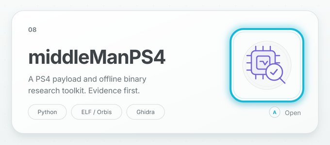</a>
 
<b>middleManPS4 · research / WIP · v0.15</b>
  
A PS4 payload lab and offline binary-analysis toolkit built around three questions: how a payload is loaded, what is inside the binaries and what is actually visible on the wire.
  
It includes ELF validation and sending, read-only firmware diagnostics, ELF/Orbis/PSF/NID inspection, JSON/Markdown reports, optional Ghidra export and passive network-metadata tools.
  
Tested on my own PS4 where documented. Read-only diagnostics and offline analysis; no PSN bypass or firmware-spoofing claims.
  
<a href="https://github.com/oakvx/middleManPS4">Code, evidence and roadmap</a>
</td>
</tr>
</table>

<a href="https://github.com/oakvx?tab=repositories"><b>Browse all my repositories →</b></a>

<h2>
<picture>
<source media="(prefers-color-scheme: dark)" srcset="./assets/headings/focus-toolbox-dark.png" />

</picture>
</h2>

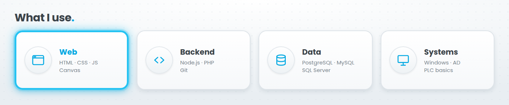

- **Design & Web:** responsive UI, visual design, accessibility, SEO, prototyping, HTML, CSS, JavaScript
- **Backend & App Logic:** Node.js, PHP, Canvas, WebCodecs, MediaRecorder, IndexedDB, Git
- **Data:** PostgreSQL, MySQL, SQL Server (T-SQL), relational data modelling
- **Reverse Engineering:** Python, C payloads, ELF/Orbis/PSF/NID, Ghidra, passive DNS/TLS/TCP metadata
- **Systems:** Windows, Active Directory, IT support, industrial software, PLC basics

> **How I like to build:** useful over flashy · local-first when it makes sense · accessible motion · evidence over assumptions.

<h2>
<picture>
<source media="(prefers-color-scheme: dark)" srcset="./assets/headings/where-ive-been-dark.png" />
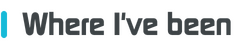
</picture>
</h2>

| When | What |
| :-- | :-- |
| **2026 →** | **Computer Engineering** at the University of Modena and Reggio Emilia (UNIMORE) |
| **Aug–Sep 2026** | **Software & automation apprentice** at Format SRL: industrial software, PLC support, SQL Server and T-SQL |
| **2023–Jun 2026** | **Freelance web developer & SEO consultant** for local businesses around Sassuolo and Scandiano |
| **May–Jun 2025** | **Erasmus+ at Starbotica, Seville:** IT support, educational activities, Windows, Active Directory and local networks |
| **2021–2026** | **Computer Science & Telecommunications** at IIS A. Volta, Sassuolo; Beautify was my final diploma project |

<h2>
<picture>
<source media="(prefers-color-scheme: dark)" srcset="./assets/headings/after-hours-dark.png" />

</picture>
</h2>

I write code with no particular purpose, rebuild things that already worked because I found a better way, and leave the computer on a little longer than intended.

| Channel | Currently tuned to |
| :-- | :-- |
| **Languages** | Italian (native) · English (C1) · Spanish (B1) · Greek (B1) · Chinese (A2) |
| **Console side quests** | Modded Nintendo 3DS (three of them), Wii U, Wii and PlayStation 4 |
| **Games I keep coming back to** | Rayman Legends · Yo-kai Watch 2: Bony Spirits · Just Dance 2017 |
| **Curiosity loop** | One simple question → far too much reading → a prototype → one more refinement |

<a href="https://oakvx.github.io/fuori-orario/"><b>Open my After Hours channel →</b></a>

<b>My avatar, in motion</b>

A few animations I made of my avatar for my website.

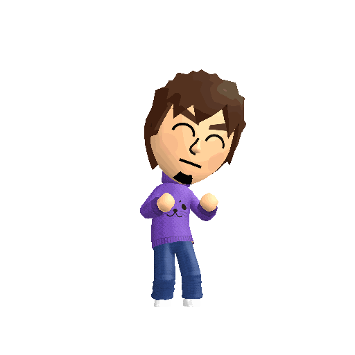
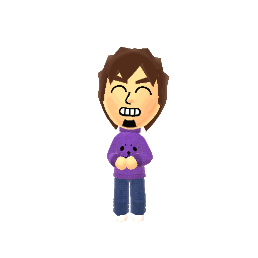
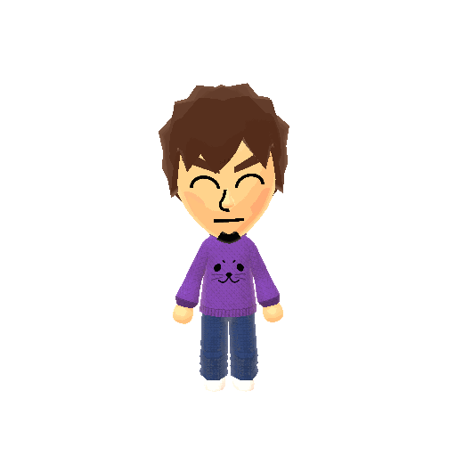
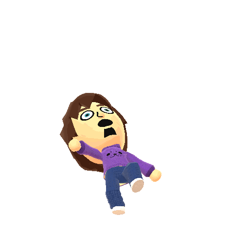
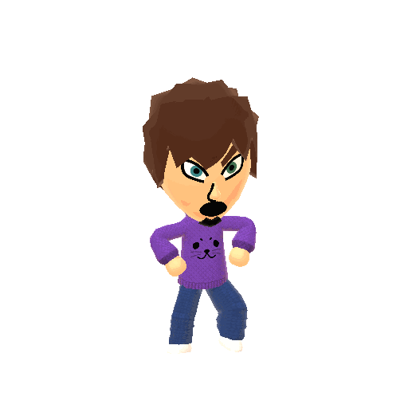

<b>Leggi in italiano</b>

Sono **Gabriele Lucia**, di Sassuolo. Studio Ingegneria Informatica all'UNIMORE e mi divido tra sviluppo software, grafica e interfacce.

Ho organizzato i progetti in tre percorsi:

- **Design & Web:** il mio portfolio, la demo inventata Spinotto Felice, la landing non ufficiale Top Gun Fly School e il sito coming-soon di Synkris.
- **Backend & logica applicativa:** [synk / SYNKRIS](https://github.com/oakvx/synkris), Brat Animator e Beautify. synk è una RC di collaudo per saloni, con Node.js, PHP, PostgreSQL, integrazioni Google Calendar e WhatsApp Web; il runtime AI locale è facoltativo. Brat Animator elabora timing, animazioni ed esportazioni direttamente nel browser.
- **Reverse Engineering:** middleManPS4, il mio laboratorio per payload PS4, analisi offline di file ELF/Orbis e osservabilità di rete sulla mia console.

Ho lavorato come sviluppatore web freelance e consulente SEO, ho fatto supporto IT durante l'Erasmus a Siviglia e mi sono occupato di software industriale, PLC e SQL Server. Fuori orario mi piacciono le console modificate, i videogiochi e le lingue straniere: oltre all'italiano e all'inglese, studio spagnolo, greco e cinese.

<a href="mailto:gabrielelucia07@gmail.com">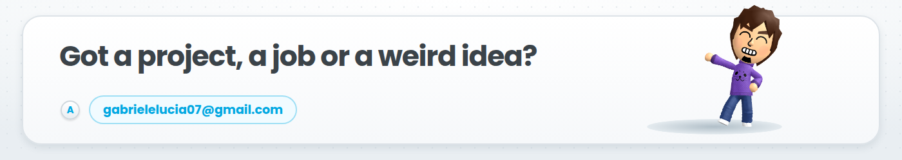</a>

<a href="mailto:gabrielelucia07@gmail.com">Email</a> &nbsp; · &nbsp;
<a href="https://oakvx.github.io/">Portfolio</a> &nbsp; · &nbsp;
<a href="https://github.com/oakvx">GitHub</a> &nbsp; · &nbsp;
<a href="https://github.com/oakvx/synkris">SYNKRIS</a>

© 2026 Gabriele Lucia · Graphics and avatar are my own work.

